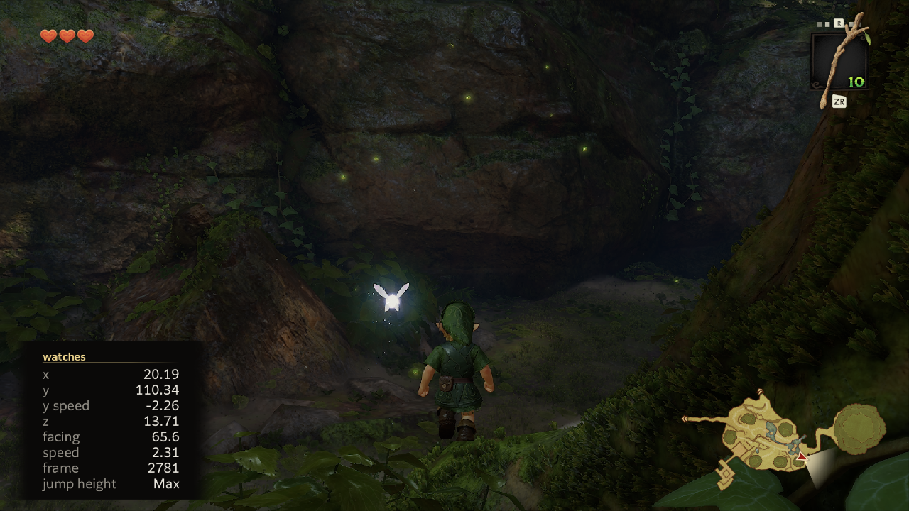
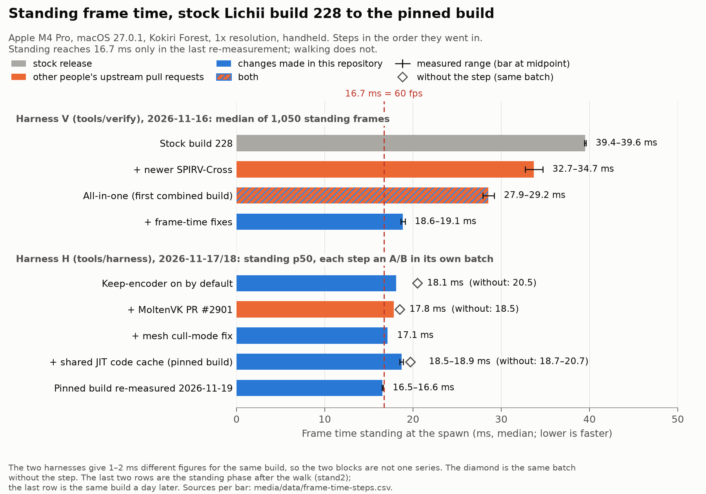
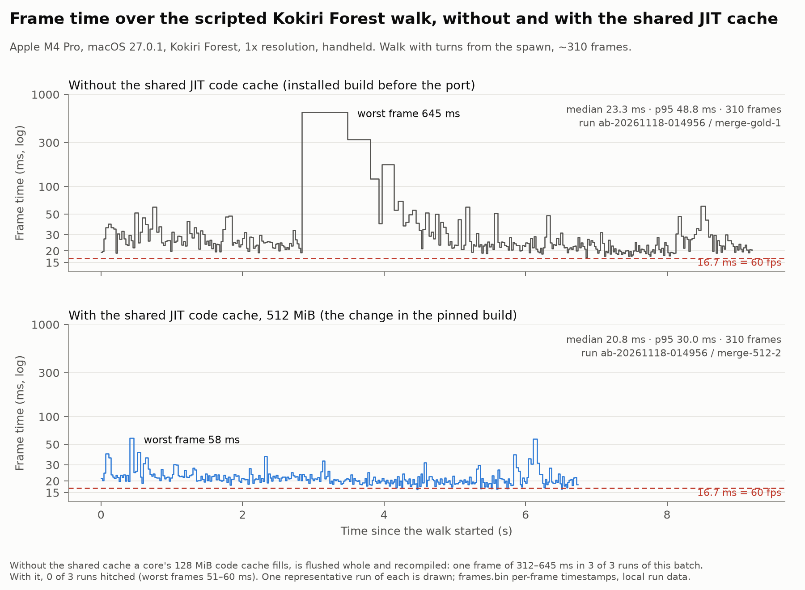

# oot26-on-mac

The 2026 Switch 2 remake of *Ocarina of Time* running in the [Lichii](https://github.com/zortos293/Lichii) emulator
on an Apple silicon Mac: one pinned build that can be rebuilt from public source, the patches it is made of, and the
research behind each of them.

No game files are here. You need your own dump of the game (title `0400486024DEC000`, v1.1.1).

## Where it stands

Measured on an Apple M4 Pro (Mac16,8, 14 cores, 48 GB), macOS 27.0.1, in Kokiri Forest at 1x resolution, handheld
mode, post-processing off, GPU accuracy Low. "Stock" is Lichii build 228 as released. Rows whose "before" is not
stock compare the pinned build with the same build minus one change, which is how those changes were measured.

| Measure | Before | Pinned build | Before is | Source |
| --- | --- | --- | --- | --- |
| Frame time standing at the spawn | 39.4–39.6 ms (25 fps) | 16.5–18.9 ms (53–60 fps), by run and harness | stock | [mac-performance](research/mac-performance/README.md), [emulator-options](research/emulator-options/README.md) |
| Frame time on the test walk | 29.2–30.0 ms | 18.9–23 ms (43–53 fps), by run and route | stock plus the open upstream pull requests | [path-to-60fps](research/path-to-60fps/README.md) |
| Worst frame on the walk | 312–645 ms, in 3 of 3 runs | 51–60 ms, no hitch in 3 of 3 runs | without the shared JIT cache | [shared-jit-cache](research/shared-jit-cache/README.md) |
| Map load | 26.1–26.6 s | 21.8–23.6 s | without the shared JIT cache | same |
| Memory | 23.0 GiB | 20.0 GiB | without the shared JIT cache | same |
| Cold boot (empty Metal shader cache) | 455–483 s | about 100 s | without MoltenVK #2901 | [emulator-options](research/emulator-options/README.md) |
| White specks on the Kokiri cave wall | 27 of 30 frames | 0 of 30 | without the cull-mode fix | [mesh-white-specks](research/mesh-white-specks/README.md) |

The most recent runs (2026-11-19, the build `./build.sh` produces, three runs): walking 19.5 / 18.9 / 19.6 ms,
standing after the walk 16.6 / 16.5 / 16.5 ms, boot to in-game 39.4 / 38.0 / 39.3 s.







More pictures, with the source of every number: [media/README.md](media/README.md).

What this is not, yet:

- **Not a steady 60 fps.** Standing still it sits at the game's 60 fps step in the latest runs (medians of
  16.5–16.6 ms); walking it does not (18.9–19.6 ms, with one frame in twenty over 26 ms).
- **Not native code execution.** The CPU side is the dynarmic recompiler with one code cache shared by the guest
  cores. Lichii's Hypervisor backend loads twice as fast and walks faster, but 2 of 26 boots had a
  corrupted picture; that work is unfinished ([TRACKER.md](TRACKER.md)).
- **Measured in one area.** Kokiri Forest, plus two walks in Gerudo Valley.
- **Compared with an old baseline.** Lichii has shipped newer builds since 228; they are not measured here.

## What the pinned build is made of

Lichii `nx2` at `8c0558a3d3` and MoltenVK `main` at `5189f8de86ec`, each with a patch series from `patches/`.
The pins are in [versions.lock](versions.lock).

| Part | Other people's open pull requests, merged in | Changes made here |
| --- | --- | --- |
| Lichii | [#1970](https://github.com/zortos293/Lichii/pull/1970) native Metal mesh shaders and Hypervisor backend (HyperCed), [#2022](https://github.com/zortos293/Lichii/pull/2022) (RomainROCH), [#1902](https://github.com/zortos293/Lichii/pull/1902) (Terobyte) | size-based rule for which mesh shaders fall back to emulation; NaN guard; shuffle-free multiply for the game's upscaling network (output identical); CPU widening of 8-bit indices; list-indirect draws; shared JIT code cache on arm64, a port of [#2101](https://github.com/zortos293/Lichii/pull/2101) |
| MoltenVK | [#2842](https://github.com/KhronosGroup/MoltenVK/pull/2842) and [#2843](https://github.com/KhronosGroup/MoltenVK/pull/2843) mesh shaders (dttdrv), [#2897](https://github.com/KhronosGroup/MoltenVK/pull/2897) (paulpan05), [#2901](https://github.com/KhronosGroup/MoltenVK/pull/2901) compile shaders on first use (frankea) | `maxPushDescriptors` 16; subgroup stages for mesh and task shaders; mesh position fix; keeping the Metal render encoder across barriers; cull mode applied to mesh draws; a frame profiler |
| SPIRV-Cross | pinned at `98cbb7c0`, which has [#2721](https://github.com/KhronosGroup/SPIRV-Cross/pull/2721) (tksuoran) and [#2686](https://github.com/KhronosGroup/SPIRV-Cross/pull/2686) (dttdrv) | |

Every change, with its measured effect and evidence, is a row in [TRACKER.md](TRACKER.md), next to what was tried
and not adopted and what is worth doing next. What is wrong, or may be wrong, with the build as pinned is in
[KNOWN-ISSUES.md](KNOWN-ISSUES.md), and only there.

## Building it

Needs an Apple silicon Mac with the Command Line Tools and these Homebrew packages (Lichii's own list, plus
`ccache`):

```bash
brew install autoconf automake boost ffmpeg fmt glslang hidapi libtool libusb lz4 ninja nlohmann-json openssl pkg-config qt@6 sdl3 speexdsp zlib zstd cmake catch2 molten-vk vulkan-loader spirv-tools vulkan-utility-libraries ccache
```

Then:

```bash
./build.sh
```

That clones Lichii and MoltenVK at the pinned commits, applies the patches, checks that the source is exactly the
pinned source, builds both, and assembles `build/app/lichii.app`. It installs nothing.

```bash
./build.sh install
```

copies the app to `/Applications/lichii.app` and keeps the app that was there as `lichii.app.before-<time>`.
`./build.sh versions` compares the tools on your machine with the ones the pinned build was made with. The app links
Homebrew's libraries, so it runs on the machine that built it and is not a redistributable bundle.

To run the game you also need your dump added as a game folder in Lichii and the settings in
[config/README.md](config/README.md).

## Folders

| Folder | Holds |
| --- | --- |
| `patches/lichii/`, `patches/moltenvk/` | the two patch series, one patch per change, in order |
| `patches/snapshot/` | each series as a single patch against its upstream commit; a check, not an input |
| `patches/experiments/` | patches that were tested and are not in the pinned build |
| `config/` | the switches the build adds, the launch environment, the emulator settings that matter |
| `research/` | finished write-ups, one folder per topic; start with [research/mac-performance](research/mac-performance/README.md) |
| `wip/` | unfinished threads |
| `tools/` | the measurement harness, the Vulkan-to-Metal state check, and the other measurement scripts |
| `media/` | charts and before/after pictures, with the scripts and data that make them |
| `build/`, `runs/` | source clones, build output and run data; not tracked |

## Running it under test

Measurements and scripted runs go through the harness in [tools/harness/](tools/harness/README.md): one emulator
at a time under a lock, input through Lichii's debug server, game state read from memory, the picture scored and
looked at. The rules are in [CLAUDE.md](CLAUDE.md).

## Changing the pinned build

A change goes in as a commit on the `gold` branch of `build/src/lichii` or `build/src/moltenvk`, a re-export of the
patch series, new commit and tree ids in `versions.lock`, and a row in `TRACKER.md`. A MoltenVK change that touches
shader translation also needs a new pipeline cache id there, which costs one boot that translates every shader
again (about 330 s); other changes keep the caches. Before that it is compared with the
installed build in the harness: same MoltenVK library in both unless MoltenVK is what changed, several runs each,
and the recorded pictures looked at, because picture corruption does not show in the logs.

## Licence

The scripts and write-ups are under the [MIT licence](LICENSE). The patches are changes to Lichii
(GPL-3.0-or-later) and MoltenVK (Apache-2.0) and stay under the licence of the project they change.

The Legend of Zelda and Ocarina of Time are Nintendo's. This project is not affiliated with Nintendo.
