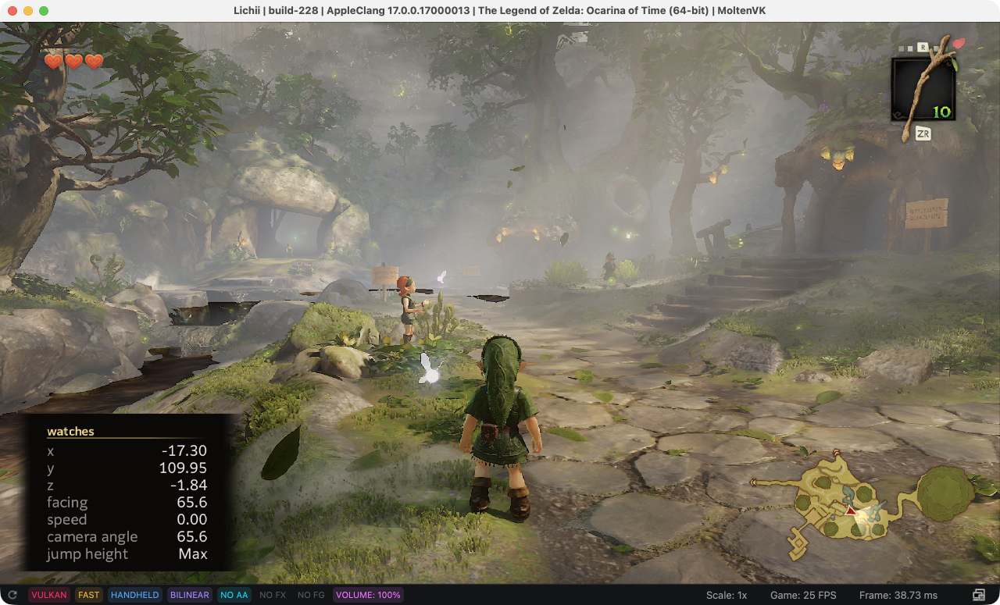
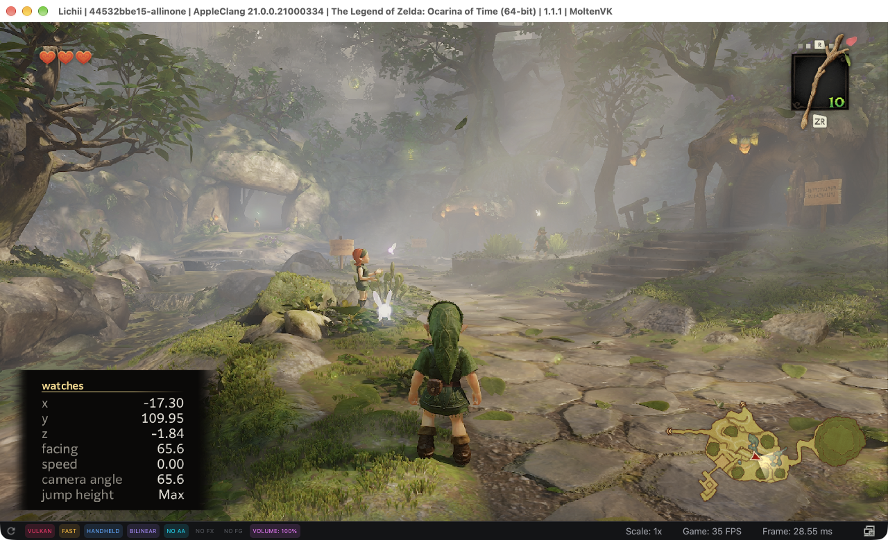
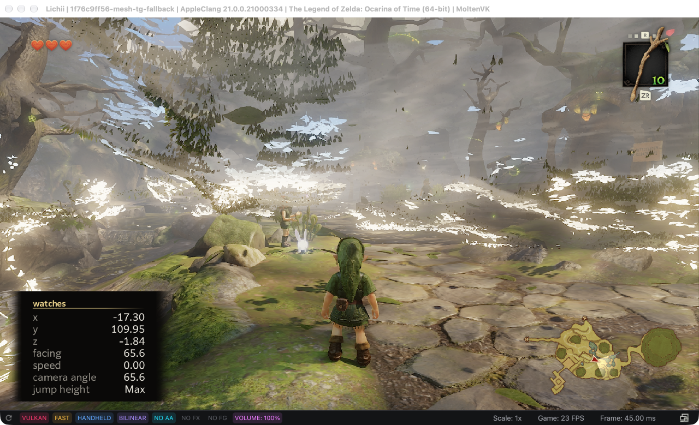
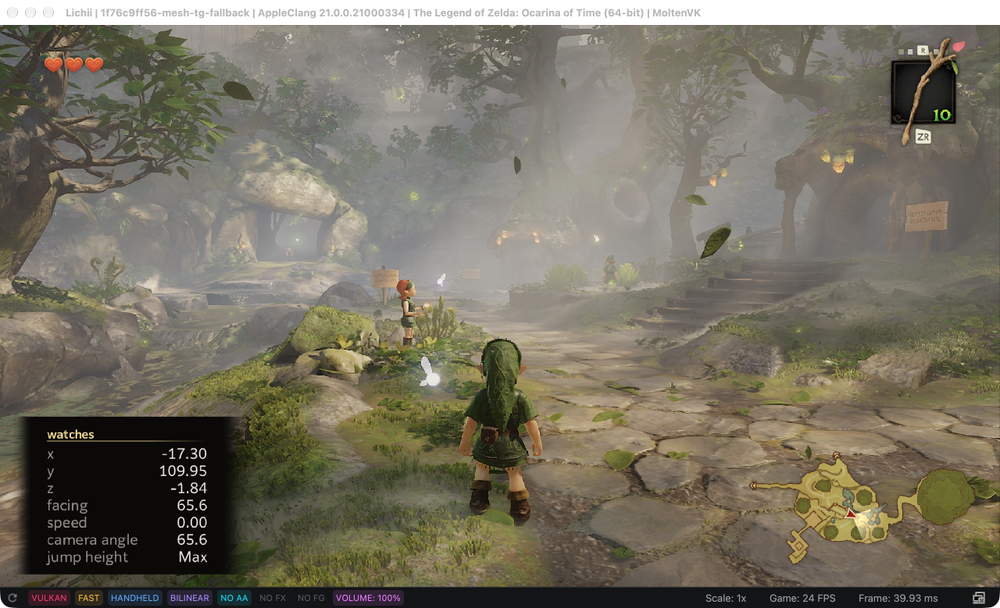
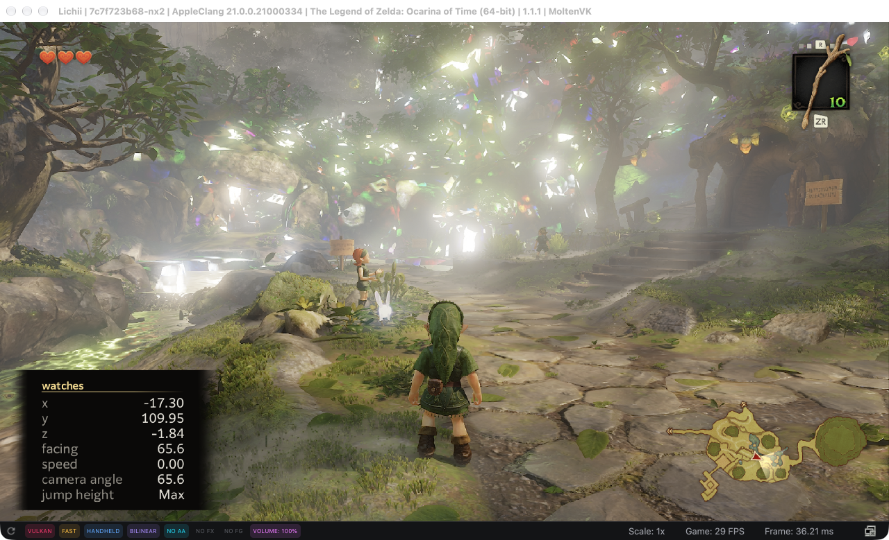

# Ocarina of Time on the Mac emulator: from 25 fps towards 60

This page is the overview of the performance and rendering work: what the frame time was, what was changed, what
each change gave, the causes found, how to measure without fooling yourself, and where each detailed write-up is.
Everything was measured on an Apple M4 Pro (Mac16,8, 14 cores, 48 GB) under macOS 27.0.1, running the 2026 Switch 2
remake of Ocarina of Time (title `0400486024DEC000`, game version 1.1.1) in the Lichii emulator (`zortos293/Lichii`,
branch `nx2`), standing at or walking from the Kokiri Forest spawn point, at 1x resolution, in handheld mode, with
post-processing off and GPU accuracy Low. Stock Lichii build 228 stands at 39.4–39.6 ms a frame (25 fps). The
pinned build in this repository does not hold 60 fps (16.7 ms): its standing medians are 16.4–18.9 ms and its walking
medians 18.7–23 ms, depending on run and harness. It also removes a walk hitch of 312–960 ms, boots from an empty
Metal shader cache in about 100 s instead of about 8 minutes, and draws the foliage without the white specks that
native mesh shaders caused.

Each claim is marked **measured** or **read** (from code or documentation). Run folders named `ab-<date>-<time>` or
by label are local run data and are not tracked.

## Results, step by step

Two harnesses produced these numbers, and their figures for the same build differ by 1–2 ms:

- **V**: `tools/verify` with a run script (copy in [patches/run.sh.txt](patches/run.sh.txt)), used on 2026-11-16.
  The figure is the median of 1,050 standing frames; walking figures are medians of each of two 944-frame walks.
- **H**: [`tools/harness`](../../tools/harness/README.md), used from 2026-11-17. It reports three medians per run:
  standing / scripted walk / standing again at the end of the walk ("stand / walk / stand2"), 300 or 600 frames per
  phase. Run-to-run noise is about ±0.5–1 ms.

Each row adds one step to the row above it, in the order the steps happened. Rows marked "alone" add one piece to
the all-in-one build instead; their savings do not add up, because once the GPU is no longer the limit, GPU savings
stop turning into frame time.

| # | Build | Frame time and other measures | What changed | Whose change | Detail |
| --- | --- | --- | --- | --- | --- |
| 0 | Stock Lichii release 228 (2026-11-15), its bundled MoltenVK 1.4.1 fork, mesh shaders emulated | 39.4–39.6 ms standing (V) | – | Lichii release | this page |
| 1 | Stock 228 with only its MoltenVK rebuilt against a newer SPIRV-Cross | 32.7–34.7 ms standing (V); one of four runs crashed about 10 s after the spawn and did not repeat in two reruns | SPIRV-Cross no longer marks its precise-arithmetic helpers "do not optimise" | SPIRV-Cross PR #2721, tksuoran (merged) | cause 1 below |
| 2 | "All-in-one": the first combined build (Lichii patches 0001–0005, MoltenVK patches 0001–0005 in [`patches/`](../../patches/)) | 27.9–29.2 ms standing (V, this page's runs); 28.7–30.9 ms in the path-to-60fps runs and 29.1–33.5 ms in the frame-breakdown runs of the same day (some instrumented), all with the same build; walking 29.2–30.0 ms | Native Metal mesh shaders and Mac support; a size-based rule for which mesh shaders fall back to emulation; NaN guard; failed mesh pipelines skipped; unchanged uniform uploads skipped; `maxPushDescriptors` 16; subgroup stages for mesh and task shaders; mesh position fix; SPIRV-Cross `98cbb7c0` | Lichii PRs #1970 (HyperCed), #2022 (RomainROCH), #1902 (Terobyte); MoltenVK PRs #2842 and #2843 (dttdrv), #2897 (paulpan05); SPIRV-Cross PRs #2686 (dttdrv) and #2721 (tksuoran); the fallback rule, NaN guard, push-descriptor cap, subgroup stages and position fix are this repository's | cause 4 below, [allinone-frame-breakdown](../allinone-frame-breakdown/README.md) |
| 3a | All-in-one + shuffle-free tensor multiply for the game's upscaling network (alone) | 24.2–24.3 ms standing (V); upscale pass 7.8 → 2.4–2.6 ms offline; output bit-identical | The upscaler's emulated tensor multiplies exchange data through workgroup memory instead of SIMD shuffles | this repository | [path-to-60fps](../path-to-60fps/README.md) |
| 3b | All-in-one + CPU widening of 8-bit indices (alone) | 28.7 ms standing (V), 1.3 ms saved; 82 conversion dispatches a frame removed | Lichii widens 8-bit index buffers on the CPU instead of MoltenVK converting them on the GPU | this repository | same |
| 3c | All-in-one + list-indirect draws (alone) | 28.8 ms standing (V), 1.2 ms saved; GPU idle 3.9 → 1.5 ms | Lichii's list-indirect path enabled on MoltenVK (a limit check had turned it off) | this repository | same |
| 3d | All-in-one + Metal encoders kept open across pipeline barriers (alone, behind a switch) | 27.5 ms standing (V), 2.5 ms saved; encoders 1,073 → 701 a frame | MoltenVK no longer ends a blit or compute encoder at every pipeline barrier | this repository | same |
| 3 | All-in-one + 3a–3d together | 18.6–19.1 ms standing (V); walks 19.7 and 20.0 ms in one full-route run | – | this repository | same |
| 4 | 3 with keep-encoder switched on by default (2026-11-17) | 18.1 / 21.3 / 17.7 ms against 20.5 / 22.1 / 20.0 ms without it (H) | Keep-encoder became the default (`MVK_P60_NO_KEEP_ENCODER=1` turns it off) | this repository | [emulator-options](../emulator-options/README.md) |
| 5 | + MoltenVK PR #2901 | Boot from an empty Metal cache 455–483 s → 78.8 s in the test build and 97.4–100.7 s in the pinned build; first boot of a new MoltenVK on a filled cache 206 → 15.4 s; standing 17.8 ms p50 against 18.5 ms (H); 14 of 14 boots with a clean picture | Shader libraries in Lichii's pipeline file are compiled when first used, not all at boot | MoltenVK PR #2901, frankea (open) | [emulator-options](../emulator-options/README.md) |
| 6 | + mesh cull-mode fix | Frames with white specks at the Kokiri cave wall 27 of 30 → 0 of 30, twice; standing 17.1 ms p50 (p90 20.0, p95 21.5 ms) on the warm check run (H) | A mesh pipeline applies its own cull mode instead of the one the previous draw left | this repository | [mesh-white-specks](../mesh-white-specks/README.md) |
| 7 | + one JIT code cache shared by the six guest cores, 512 MiB (`EDEN_NX2_SHARED_JIT_CACHE=512`): **the pinned build** | Walk hitches 3 of 3 runs → 0 of 3; worst walk frame 312–645 → 51–60 ms; walk p95 46.1–51.4 → 28.1–30.1 ms; map load 26.1–26.6 → 21.8–23.6 s; memory 23.5 → 20.5 GB; standing p50 18.7–20.7 → 18.5–18.9 ms (H, three runs each) | Guest code is compiled once into one cache larger than 128 MiB instead of six times into six private 128 MiB caches | this repository: a port of Lichii PR #2101 (zortos293, x86-64 only, open) to dynarmic's arm64 backend | [shared-jit-cache](../shared-jit-cache/README.md) |

Also measured on 2026-11-16 (V), for reference: Lichii `nx2` at `7c7f723` with the old MoltenVK ran at 46.4 ms,
about 7 ms slower than release 228 with the same library, and at 32.3–34.2 ms with the newer SPIRV-Cross. A bilinear
stand-in for the game's upscaling network (in the build, off by default) gives 22.0 ms alone and 19.2–19.4 ms
standing with 3b–3d, with a softer picture.

**Most recent confirmation** (measured 2026-11-19, H, run ab-20261119-035532, 600-frame phases, three runs each):
the installed pinned build against a rebuild from this repository's patch series by `./build.sh`.

| | Installed | Rebuilt from `patches/` |
| --- | --- | --- |
| Walk median | 20.5 / 19.4 / 19.4 ms | 19.1 / 18.7 / 18.9 ms |
| Standing after the walk | 17.0 / 16.5 / 16.6 ms | 16.5 / 16.5 / 16.6 ms |
| Load, including boot | 47.6 / 43.3 / 42.3 s | 43.7 / 37.2 / 42.4 s |
| Memory | 19.5–20.5 GB | 19.5–20.5 GB |

The first installed run had heavier background load. The rebuild reproduces the installed build; it is not a
speed-up.



*Stock build 228 at the spawn point (2026-11-16).*



*The all-in-one build at the same spot (2026-11-16): the picture matches stock by eye.*

## The translation chain

Switch 2 GPU machine code → Lichii's shader recompiler → SPIR-V → SPIRV-Cross (built into MoltenVK) → Metal Shading
Language → Apple's Metal compiler → GPU code. Lichii talks Vulkan; MoltenVK turns Vulkan into Metal. On the CPU side,
the dynarmic JIT recompiles the game's arm64 code into arm64 host code. Most of what follows is a fault in one link
of these chains.

## Causes found, largest first

### 1. SPIRV-Cross marked its precise-arithmetic helpers "do not optimise" (about 5–12 ms)

**Measured.** The game's shaders ask for exact floating-point results (`NoContraction`). SPIRV-Cross implemented that
with helper functions `spvFMul` / `spvFAdd` tagged `[[clang::optnone]]`, so Metal neither inlined nor optimised them,
and the game uses them everywhere. Stripping the tag by a text rewrite took one build from 43.7 to about 32 ms (31.3
and 32.4 ms) with the same picture. SPIRV-Cross PR #2721 (merged 2026-10-28) fixes it properly on Metal Shading
Language 3.2 and later. Swapping only the library in stock release 228 gives 39.5 → about 34 ms. No MoltenVK
release carries this fix (see "Upstream state").

### 2. The game's upscaler emulated with shuffles (7.9 ms)

**Measured** in [allinone-frame-breakdown](../allinone-frame-breakdown/README.md). One compute pass, the game's
1440×810 → 1920×1080 neural network, costs 7.9 ms because Lichii emulates each of its tensor-core matrix multiplies
(105 per thread) with cross-thread shuffles. Options, all measured in [path-to-60fps](../path-to-60fps/README.md):

- Lichii's existing FSR 3.1 replacement (`EDEN_NX2_DLSS_REPLACEMENT=fsr`): saves 5.2 ms; not the game's image.
- A bilinear stand-in (`P60_OOT_BILINEAR=1` with the FSR switch): saves 8.0 ms; softer image. Off by default.
- A shuffle-free multiply through workgroup memory: saves 5.7 ms; output bit-identical to the game's. On by default.

A normal launch of the pinned build sets no environment (its `Info.plist` has no `LSEnvironment` key), so it runs
the game's own network with the shuffle-free multiply.

### 3. Emulation-layer overhead (about 3.5 ms on the all-in-one)

**Measured** by the same two write-ups. The all-in-one opens about 1,070 Metal encoders per frame. Three fixes are
in the pinned build:

- MoltenVK ended the Metal encoder at every pipeline barrier; keeping blit and plain compute encoders open saves
  2–2.5 ms. Its fence handling was reviewed (see [emulator-options](../emulator-options/README.md)) and it is on by
  default.
- Widening 8-bit index buffers on the CPU instead of in 82 GPU passes saves 1.3 ms.
- Lichii's list-indirect feature was off on MoltenVK because of a limit check (MoltenVK reports 2^30, Lichii asked
  for 2^31−1); enabling it saves 1.2 ms.

### 4. Native mesh shaders: three faults before the picture is right

Stock MoltenVK has no mesh shaders, so Lichii emulates them with a compute pass and a draw. MoltenVK PR #2842 adds
native ones. Three things had to be fixed before the picture was correct (all **measured**):

1. **`maxPushDescriptors`.** MoltenVK main reports 287; Lichii then pushes sets of 37 buffers, 5 compute pipelines
   fail and the tree canopy disappears. Capping it at 16, as the MoltenVK fork that Lichii ships already does, fixes
   it. Detail: [compute-buffer-bounds](../compute-buffer-bounds/README.md).
2. **Subgroup stages.** PR #2842 does not list mesh and task in `subgroupSupportedStages`. Lichii then generates a
   no-subgroups version of each mesh program in which all 32 threads work on the same element, and the canopy is
   drawn as white blobs. Two lines in `MVKDevice.mm` fix it. Detail:
   [mesh-native-colours](../mesh-native-colours/README.md).
3. **Mesh positions.** Lichii declares the mesh position as a standalone `BuiltIn Position` output. For that form
   SPIRV-Cross applies neither the Y flip nor the depth fixup (SPIRV-Cross issue #2717, open; the depth half is
   **read** from `emit_mesh_outputs()`, which has no `fixup_clipspace` handling at all). Foliage is drawn upside
   down and the ground grass is missing. Adding these two lines after the copy in the generated source gives a
   correct picture:

   ```cpp
   spvV.gl_Position = gl_Position[spvVI];
   spvV.gl_Position.z = (spvV.gl_Position.z + spvV.gl_Position.w) * 0.5;
   spvV.gl_Position.y = -(spvV.gl_Position.y);
   ```

   The Y line alone, without the depth line, was never tested on screen.



*Without the position fix: foliage drawn upside down where the canopy should be, ground grass missing.*



*With the two added lines: the picture matches stock at the spawn point.*

**Speed** (measured, two readings on different builds and days). On 2026-11-16, with all three faults fixed, native
mesh shaders measured 43.5 ms against 41–42 ms for the emulated path (V), so no gain. On 2026-11-17, on the build
with keep-encoder, forcing every mesh shader to be emulated (Mesh shaders = Compute) gave 23.5 / 23.2 / 21.2 ms
against 20.3 / 21.3 / 19.1 ms native (H): native was about 2 ms faster. Turning off all mesh draws
(`EDEN_NX2_NO_MESH`, a diagnostic) saves only 0.5–1 ms, so mesh foliage is a small part of the frame either way.

**Metal's limits for mesh pipelines** (measured): threadgroup memory ≤ 32,768 bytes, mesh output ≤ 32,768 bytes,
the two together ≤ 61,440 bytes. Mesh shader counts differ between write-ups because they count different sets:

| Set | Mesh shaders | Over 32,768 bytes of threadgroup memory |
| --- | --- | --- |
| In the archives game version 1.1.1 loads ([shader-extraction](../shader-extraction/README.md)) | 440, plus 9 in the engine's AGL archive (449) | 10, all foliage, as Lichii and SPIRV-Cross lay them out (worst 48,412 bytes; the data really needed is 16,640) |
| Reached in Kokiri Forest, in a MoltenVK shader dump ([mesh-threadgroup-memory](../mesh-threadgroup-memory/README.md)) | 53 (51 cached programs, 53 codes) | 4 (34,076 to 42,012 bytes) |
| Demoted to emulation by Lichii PR #1970's own rule, which trusts MoltenVK's reported 12,284-byte limits | 36 of the 43 in an earlier cache; 256 of the 440 by the size model | – |
| Demoted by this repository's size rule ([mesh-fallback](../mesh-fallback/README.md)) | the 10 over the real limit (4 of the 53 reached) | – |

### 5. GPU idle between command buffers (3.9 ms on the all-in-one; cause not settled)

**Measured** with the MoltenVK frame profiler on the all-in-one and on the stand-in build: the GPU waits 3.9 ms a
frame for commands, with the same total whether FSR removes 5 ms of GPU work or not. About 2 ms of it is one gap per
frame at the frame boundary: the GPU finishes and the next frame's first commands arrive about 2 ms later
([path-to-60fps](../path-to-60fps/README.md)). List-indirect alone cut the idle to 1.5 ms, yet the build with all
three overhead fixes still showed 3.9 ms. On the later keep-encoder build, the Hypervisor comparison measured
2.2–2.8 ms of idle a frame with the JIT. A trace of Lichii's GPU threads on that build
([emulator-options](../emulator-options/README.md), "Where the GPU's idle time goes") found the thread that feeds
Metal idle 12–14 ms of every frame while the command thread waits on semaphores that other GPU channels' work
releases (6.4–7.5 ms a frame). That points at the game's channel-to-channel waits, but no fix has tested it, so the
cause is open. This idle is what stands between about 18 ms and 16.7 ms.

### 6. The walk hitch: a full flush of the JIT code cache

**Measured** ([emulator-options](../emulator-options/README.md), [shared-jit-cache](../shared-jit-cache/README.md)).
On arm64 each guest core had a private 128 MiB code cache. During play a cache filled and was flushed whole, and the
code in use was compiled again on the spot: one frame of 312–960 ms in about half of the walks. How often it hitched
depended on the route and phase length: 2 of 11 runs with 600-frame phases on the fixed route, 4 of 5 on the walk
with turns, 3 of 3 in the shared-cache validation. 78% of the blocks compiled in one boot were repeats, mostly the
same code compiled by each of the six cores. One shared cache, larger than 128 MiB, removes both.

### 7. Cold boots: every cached shader library compiled one at a time

**Measured** ([emulator-options](../emulator-options/README.md)). MoltenVK compiled every library in Lichii's
pipeline file (about 4,700) one at a time at boot, so a boot after any change to the Metal cache took 455–483 s.
MoltenVK PR #2901 compiles each library when it is first used. The 78.8 s (test build) and 97.4–100.7 s (pinned
build) figures for a cold boot with #2901 come from different apps and runs; the difference was not looked into.

### 8. White specks: mesh draws ran with a left-over cull mode

**Measured** ([mesh-white-specks](../mesh-white-specks/README.md)). MoltenVK PR #2842 treats a mesh pipeline as a
point list, so the encoder never applies its cull mode and a mesh draw inherits the previous draw's. The moss colour
draws ran with back-face culling the game never asked for, and the white clear colour showed through. The
before-fix figure is 27 of 30 speckled frames in the independent check and 28 of 30 in the run that found the fault
(different runs of the unfixed build).

## Things that did not help

All **measured** at the spawn point: raising the flush budget (`EDEN_NX2_FLUSH_DRAWS` 1024 or 4096); marking
positions invariant; the shader memory layout (worth 0.3–0.5 ms); render-pass restarts as such; running a frame
ahead; presenting outside the command buffer; turning off the 500 µs fence-flush batching (30.4 ms, twice the command
buffers). About 60 settings and switches were also measured one by one; the defaults win almost everywhere
([emulator-options](../emulator-options/README.md)). The full list of what was tried is in
[TRACKER.md](../../TRACKER.md).

Explanations that were tested and are wrong: the missing grass is not the depth-EQUAL colour pass or position
invariance (it was the Y flip); the 51 command buffers per frame are not the main cost; a first-group offset, a
thread-count mismatch and task-to-mesh payload pairing are not involved.

## How to measure without fooling yourself

Each of these produced a false result at least once.

1. **Lichii's pipeline cache stores translated shader source.** A new SPIRV-Cross never runs if an older build wrote
   `~/.cache/lichii/shader/<title>/vulkan_pipelines.fork-v54.bin`. Give every build its own.
2. **The main shader cache is shared too** (`lichii-cache.v2.bin`), and every build appends to it. One run showed
   shards in the tree canopy; four runs with a private cache did not. Not proven to be the cause, but nothing else
   differed.

   

   *Shards in the canopy in a run that shared its shader cache with other builds.*

3. **A different MoltenVK library makes the next boot cold.** MoltenVK stamps its pipeline-cache identity with the
   git commit it was built from, so a library built from another commit invalidates Lichii's stored pipeline file
   and the next boot translates and compiles every shader again: 334 s measured on 2026-11-19, against about 100 s
   for a cold Metal cache with a valid pipeline file and 455–483 s without MoltenVK #2901. `build.sh` therefore
   produces the same commit ids on every rebuild. Even a rebuild of untouched source changes the binary, and the
   Metal cache is tied to the binary: compare boot and load on a build's second boot, give two apps the same library
   file when MoltenVK is not what changed, and boot two runs of one build back to back.
4. **Other work on the machine.** Another build adds 3–5 ms a frame; another process's cold Metal compiles doubled
   frame times; Metal compiles or builds in parallel added 10–30 ms to a run. Log the load average, build with
   `nice -n 19 … -j 6`, and check that a run's phases agree.
5. **App Nap.** With the window hidden, macOS can move the emulator to the efficiency cores: 50–60 ms frames with
   identical GPU work (5 of 9 runs in one series). Keep the window visible or set `MVK_P60_NO_APPNAP=1`.
6. **The walk hitch is a coin flip without the shared JIT cache.** Compare walk p90, p95, p99, maximum or mean only
   within hitched runs or within clean runs, and count hitches over several runs.
7. **Name the load you quote.** The figures in the write-ups measure different spans: "map load" from the loading
   screen to Link in game (19.8 s in the one run with a per-compile JIT log); harness "load − boot" (26.1–26.6 s
   without and 21.8–23.6 s with the shared cache); "save load" in the shared-cache batches (17.2 → 16.7 s); and
   "spawn", from launch to Link standing at the spawn, boot included (about 42–47 s with the JIT, about 20–25 s with
   the Hypervisor backend).
8. **Look at the pictures.** Frame times and logs never show a broken picture; three breakages were found only by
   eye. Score every screenshot (share of clipped white pixels: 2.9–3.3% is normal at the spawn).
9. **Freezes and guest crashes.** About one run in forty dies in the game's own code ("Cannot execute instruction at
   unmapped address", or a jump to address 0 around a load) on every build. Do not blame a build for one.
10. **The status bar's fps is not a measurement.** Use per-frame times from the harness's frame clock.

Stop Lichii with `kill -9`, never run its binary with `--version` or `--help` (both open the GUI, and quitting
rewrites `qt-config.ini`), and settle nothing under about 1.5 ms with a single run. The full list of rules is in
[TRACKER.md](../../TRACKER.md), "Measurement rules".

## Upstream state on 2026-11-19

States as checked on 2026-11-19, from [TRACKER.md](../../TRACKER.md), "Upstream".

| Number | Author | What | State | In the pinned build |
| --- | --- | --- | --- | --- |
| Lichii PR #1970 | HyperCed | Better macOS support with Hypervisor (native mesh shaders, per-shader fallback, Hypervisor CPU backend) | open (head now `b697762630`) | at `1f76c9ff56`, with this repository's demotion rule |
| Lichii PR #2022 | RomainROCH | Skip failed mesh pipelines when seeding vertex-input lenders | merged 2026-11-17 | at `f1f0dcc13a` |
| Lichii PR #1902 | Terobyte | Skip native uniform bank re-uploads whose bytes did not change | open | at `c7e22dabc9` |
| Lichii PR #2101 | zortos293 | One x64 A64 code cache shared by a process's cores | open | ported to arm64 |
| Lichii issue #2180 | SokolskyNikita | Shared JIT code cache for the arm64 backend: offering a PR | open, 2 bot replies | – |
| Lichii PR #1366 | auz466 | Precompiled pipelines built from the player's own play | open | tested with 4 Mac changes (taken into the PR), not in the build |
| MoltenVK PR #2842 | dttdrv | Add `VK_EXT_mesh_shader` support | open | at `c516eb42`; test report and the cull-mode fault posted as comments, the patch not posted; dttdrv replied that mesh and task now report subgroup support |
| MoltenVK PR #2843 | dttdrv | Specialization constant values for array sizes | open | at `cae05219` |
| MoltenVK PR #2897 | paulpan05 | Batch indirect-count draw conversions into one compute pass | open | at `f2594b14` |
| MoltenVK PR #2901 | frankea | Compile pipeline cache shader libraries when first used | open | included |
| MoltenVK PR #2905 | Rai-Aarav | Let threads sharing a pipeline cache compile concurrently | open | tested and rejected (picture corruption) |
| MoltenVK issue #2907 | SokolskyNikita | Stack overflow in SPIRV-Cross `CFG::walk_from` on a secondary thread | open | – (the Precache shaders Always crash) |
| SPIRV-Cross PR #2721 | tksuoran | Inline precise arithmetic helpers on MSL 3.2 | merged 2026-10-28 | through the `98cbb7c0` pin |
| SPIRV-Cross PR #2686 | dttdrv | Fix several mesh and task shader issues | merged 2026-10-28 | through the pin |
| SPIRV-Cross issue #2717 | nftmago | `flip_vert_y` skips standalone mesh positions | open | worked around by a text rewrite; repro and the missing depth fixup posted as a comment |

- **MoltenVK is deprecated** (**read**, its README since 2026-10-13, MoltenVK #2874): community-maintained, best
  effort, with KosmicKrisp recommended on Apple silicon. Nothing has merged since. A new contribution needs a
  Khronos CLA.
- **Lichii ships a prebuilt MoltenVK** from the fork `HyperCed/Ryujinx.MoltenVK` (**read**, `cpmfile.json`, release
  `v1.4.1-ryujinx-sparse`), based on MoltenVK 1.4.1 and owned by the author of Lichii PR #1970. Its `lichii-mesh`
  branch has native mesh shaders but, as far as reading it shows, neither the position fix nor the subgroup stages,
  and removes the slow-helper tag only behind `MVK_NO_OPTNONE`. That fork is where a library change has to land to
  reach users.
- **Not offered upstream anywhere yet:** the size-based fallback rule, the NaN guard, the subgroup stages, the
  position fix, the cull-mode fix, keep-encoder, the shuffle-free multiply, 8-bit index widening, list-indirect and
  the push-descriptor cap. The shared JIT cache port is offered in Lichii issue #2180.

## Open questions

1. **Current Lichii.** Every comparison is against stock build 228 (2026-11-15); Lichii is at build 341 as of
   2026-11-19, and PR #2022 has since merged. Lichii `nx2` of 2026-11-16 was 7 ms slower than 228 with the same old
   MoltenVK (46.4 against 39.5 ms); not bisected (142 commits apart).
2. **The CPU-to-GPU hand-off.** GPU work is 15.5–16.4 ms but standing frames are 17–19 ms. Located: a gap of about
   2 ms after the end-of-frame flush, downloads of GPU-written buffers that could happen only when needed (up to
   1.0 ms), occlusion queries that could accumulate once per command buffer (up to 0.5 ms). Whether the idle comes
   from the game's semaphore waits between GPU channels is not settled (cause 5). Also unexplained: list-indirect
   alone cut the idle from 3.9 to 1.5 ms, but the combined build still showed 3.9 ms.
3. **The Hypervisor backend.** Lichii PR #1970's backend, with fixes and speed patches that are not in the pinned
   build, walked at about 17.5 ms against 22 ms for the JIT with private caches and reached the spawn in about 20 s
   against 44 s, but 2 of 26 boots had a corrupted picture with clean logs. Its cause is not found, and the backend
   was never compared with the shared JIT cache. See [emulator-options](../emulator-options/README.md) and
   [TRACKER.md](../../TRACKER.md).
4. **One blown-out picture on 2026-11-19.** One run of the installed pinned build had white and pink over the whole
   scene (58.7% clipped pixels against a normal 2.9–3.3%) with normal frame times. The next eight runs were clean,
   and 58 earlier scored runs of the JIT builds had none. Cause not found.
5. **Keep-encoder elsewhere.** Its code was reviewed, but on screen only the Kokiri spawn and walking routes were
   checked.
6. **The Y flip alone**, without the depth line: claimed wrong in the SPIRV-Cross #2717 comment, never tested.
7. **Other areas and modes.** Only Kokiri Forest (and two Gerudo Valley walks) is measured; docked mode is about
   5 ms slower and its picture was never looked at; KosmicKrisp lacks mesh shaders
   ([moltenvk-offramp](../moltenvk-offramp/README.md)) and was never run. Open sightings: Hyrule Field white tufts
   while shaders build, Gerudo Valley water streaks, a thin wrong fog layer over the grey grass at the spawn.
8. **What each all-in-one piece gives.** Only the SPIRV-Cross update was measured alone; Lichii PR #1902 and MoltenVK
   PR #2897 were never measured on their own.

## Detailed write-ups

| Topic | File |
| --- | --- |
| Per-pass frame breakdown of the all-in-one | [allinone-frame-breakdown](../allinone-frame-breakdown/README.md) |
| The fixes from 29 ms to 19 ms: upscaler, overhead, GPU idle | [path-to-60fps](../path-to-60fps/README.md) |
| Settings and switches measured one by one; keep-encoder, #2901, the walk hitch, compilers, Hypervisor | [emulator-options](../emulator-options/README.md) |
| One JIT code cache shared by the guest cores | [shared-jit-cache](../shared-jit-cache/README.md) |
| White specks at the cave wall (the cull-mode fault) | [mesh-white-specks](../mesh-white-specks/README.md) |
| Why native mesh foliage had wrong colours (subgroups, NaN guard) | [mesh-native-colours](../mesh-native-colours/README.md) |
| Metal's threadgroup limit and the oversized shaders | [mesh-threadgroup-memory](../mesh-threadgroup-memory/README.md) |
| Per-shader fallback by real size | [mesh-fallback](../mesh-fallback/README.md) |
| The push-descriptor overflow | [compute-buffer-bounds](../compute-buffer-bounds/README.md) |
| Extracting all the game's shaders | [shader-extraction](../shader-extraction/README.md) |
| Metal validation run | [metal-validation](../metal-validation/README.md) |
| Alternatives to MoltenVK | [moltenvk-offramp](../moltenvk-offramp/README.md) |
| nxnative evaluation | [nxnative](../nxnative/README.md) |
| Vulkan-to-Metal raster state check (found the cull fault) | [tools/statecheck](../../tools/statecheck/README.md) |
| Prebuilt shaders against first-visit stutter (unfinished) | [wip/shader-prebuild](../../wip/shader-prebuild/README.md) |
| Nvidia shaders against their Metal translations (unfinished) | [wip/shader-metal-analysis](../../wip/shader-metal-analysis/guest-vs-metal-shaders/README.md) |

## Files

- [shots/](shots/): stock build 228, the all-in-one, native mesh before and after the position fix, the canopy shards.
- [patches/run.sh.txt](patches/run.sh.txt): the run script behind the 2026-11-16 (V) numbers. It expects a local
  build folder layout that is not part of this repository.
- The patch series of the pinned build are in [`patches/lichii/`](../../patches/lichii/) and
  [`patches/moltenvk/`](../../patches/moltenvk/), and `./build.sh` rebuilds it from them.
